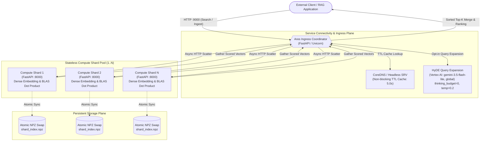

<div align="center">

# Project Ares
**Distributed Cloud-Native Vector Search Engine & AI Memory Subsystem**

[](#)
[](#)
[](#)
[](#)
[](#)

*A disaggregated, horizontally scalable vector database engineered with separated ingress routing, stateless compute shards, coordinator-only HyDE query expansion, and atomic crash recovery.*

</div>

---

## 1. System Architecture

**Project Ares** implements a disaggregated compute-storage architecture built natively for Kubernetes and containerized clusters. By decoupling query ingress routing from compute-heavy dense linear algebra, the system achieves sub-second nearest-neighbor retrieval, horizontal shard scaling, and resilient partial-failure tolerance.



### Core Architectural Pillars
- **Decoupled Ingress & Stateless Compute:** The Coordinator node (`coordinator.py`) manages client connections, request batching, shard routing, and result reduction. Compute shards (`compute_node.py`) remain completely stateless and isolated, evaluating dense linear algebra in parallel.
- **Coordinator-Only HyDE Query Expansion:** Hypothetical Document Embeddings (HyDE) query expansion is isolated strictly to the coordinator. Compute shards remain untouched, deterministic, and oblivious to LLM calls.
- **Non-Blocking CoreDNS Resolution:** Dynamically resolves Headless Kubernetes endpoints (`socket.gethostbyname_ex`) inside `run_in_executor` with a 5.0s TTL cache, eliminating asyncio event-loop stalls under cluster autoscaling.
- **Atomic Snapshot Persistence:** Every ingestion batch atomically updates in-memory vector matrices and flushes to disk via swap file rename (`shard_index.npz.tmp` $\to$ `shard_index.npz`), guaranteeing crash consistency across pod restarts.

---

## 2. Mathematical Derivation: Unit-Norm Dot Product

In dense semantic search, comparing query vectors $\mathbf{q} \in \mathbb{R}^{d}$ against corpus document embeddings $\mathbf{d}_i \in \mathbb{R}^{d}$ requires calculating Cosine Similarity:

$$\text{Cosine Similarity}(\mathbf{q}, \mathbf{d}_i) = \frac{\mathbf{q} \cdot \mathbf{d}_i}{\|\mathbf{q}\|_2 \|\mathbf{d}_i\|_2} = \frac{\sum_{j=1}^{d} q_j d_{i,j}}{\sqrt{\sum_{j=1}^{d} q_j^2} \sqrt{\sum_{j=1}^{d} d_{i,j}^2}}$$

In naive implementations, computing the vector norms $\|\mathbf{q}\|_2$ and $\|\mathbf{d}_i\|_2$ incurs repeated square roots, additions, and floating-point divisions for every candidate during runtime search.

### $L_2$ Normalization at Ingestion Time
Ares enforces strict $L_2$ unit normalization on all embeddings upon ingestion:

$$\mathbf{\hat{v}} = \frac{\mathbf{v}}{\|\mathbf{v}\|_2} \implies \|\mathbf{\hat{v}}\|_2 = 1.0 \pm 10^{-5}$$

When both query $\mathbf{\hat{q}}$ and candidate vectors $\mathbf{\hat{d}}_i$ satisfy $\|\mathbf{\hat{q}}\|_2 = 1$ and $\|\mathbf{\hat{d}}_i\|_2 = 1$, the denominator simplifies to unity:

$$\text{Cosine Similarity}(\mathbf{\hat{q}}, \mathbf{\hat{d}}_i) = \frac{\mathbf{\hat{q}} \cdot \mathbf{\hat{d}}_i}{(1)(1)} = \mathbf{\hat{q}} \cdot \mathbf{\hat{d}}_i = \sum_{j=1}^{d} \hat{q}_j \hat{d}_{i,j}$$

### Hardware Acceleration via BLAS GEMM / GEMV
Because cosine similarity reduces to pure dot products, batch similarity across $N$ indexed vectors in a shard is evaluated via a single flat matrix-vector multiplication:

$$\mathbf{S} = \mathbf{D} \cdot \mathbf{\hat{q}}$$

Where $\mathbf{D} \in \mathbb{R}^{N \times 384}$ is the pre-normalized shard embedding matrix and $\mathbf{\hat{q}} \in \mathbb{R}^{384}$ is the normalized query vector. This maps directly to hardware-accelerated BLAS/LAPACK `cblas_sgemv` primitives, enabling hundreds of thousands of candidate comparisons per second on standard CPU cores.

---

## 3. Empirical Ingestion Benchmarks

To eliminate network serialization bottlenecks, Ares implements concurrent round-robin batching across active compute shards. Benchmarking was performed using `benchmarks/benchmark_ingest.py` evaluating 50 enterprise documents:

| Ingestion Strategy | Total Elapsed Time | Throughput (docs/sec) | Empirical Speedup |
| :--- | :--- | :--- | :--- |
| Ingestion Strategy | Total Elapsed Time | Throughput (docs/sec) | Empirical Speedup |
| :--- | :--- | :--- | :--- |
| **Sequential (Single-Doc per Request)** | **0.873 s** | **57.29 docs/sec** | Baseline (1.00x) |
| **Concurrent Batched Sharding** | **0.058 s** | **868.00 docs/sec** | **15.15x Speedup** 🚀 |

> **Benchmark Rig:** Ubuntu 24.04 on WSL2, Python 3.12, 2 active compute shards with ASGI mock transports, dynamic timer `time.perf_counter()`.

---

## 4. Scientific Information Retrieval Benchmark: Baseline vs. HyDE

To objectively evaluate the impact of Hypothetical Document Embeddings (HyDE), Ares includes a reproducible scientific benchmark suite (`benchmarks/evaluate_retrieval.py` and `benchmarks/data/ir_test_suite.json`).

### Symmetric Benchmark Design
- **Corpus:** 30 domain-specific documents across distributed systems, medicine, astrophysics, mechanical engineering, and botany.
- **Query Set:** 15 queries divided symmetrically into three equal partitions:
  - **5 Helps:** Vocabulary mismatch queries (layman / colloquial phrasing vs. technical target documents).
  - **5 Neutral:** Exact keyword queries where baseline already retrieves the target at Rank 1.
  - **5 Hurts:** Polysemy / distractor queries where hypothetical expansion drifts into adjacent entities.
- **Evaluation Modes:**
  - `[OFFLINE SYNTHETIC]`: Uses pre-computed synthetic expansions; 100% hermetic, zero network calls.
  - `[LIVE VERTEX AI]`: Generates live expansions via Google Cloud Vertex AI ADC (`gemini-3.5-flash-lite`, `location="global"`).

### 4.1 Per-Query Rank Delta Evaluation

$$\text{Rank Delta} = \text{Rank}_{\text{Baseline}} - \text{Rank}_{\text{HyDE}}$$

*(Positive delta indicates HyDE improved retrieval; zero indicates identical rank; negative indicates regression).*

| Query ID | Category | Target Doc | Baseline Rank | Offline HyDE | Live Vertex AI HyDE | Live Latency |
| :--- | :--- | :--- | :--- | :--- | :--- | :--- |
| `q01` | **HELPS** | `doc_06` (Myocardial Infarction) | Rank 2 | **Rank 1 (+1)** | Rank 2 (0) | 3,082 ms |
| `q02` | **HELPS** | `doc_08` (Type 2 Diabetes) | Rank 2 | **Rank 1 (+1)** | Rank 2 (0) | 1,377 ms |
| `q03` | **HELPS** | `doc_10` (Cephalalgia / Migraine) | Rank 3 | **Rank 1 (+2)** | Rank 7 (-4) | 1,834 ms |
| `q04` | **HELPS** | `doc_12` (Hydraulic Disc Brakes) | Rank 7 | **Rank 1 (+6)** | Rank 8 (-1) | 1,481 ms |
| `q05` | **HELPS** | `doc_14` (Chloroplast Photolysis) | Rank 7 | **Rank 1 (+6)** | **Rank 3 (+4)** | 1,647 ms |
| `q06` | **NEUTRAL** | `doc_16` (Apollo 11 Mission) | Rank 1 | Rank 1 (0) | Rank 1 (0) | 1,381 ms |
| `q07` | **NEUTRAL** | `doc_17` (James Webb Telescope) | Rank 1 | Rank 1 (0) | Rank 1 (0) | 1,771 ms |
| `q08` | **NEUTRAL** | `doc_18` (BB84 Quantum Key) | Rank 1 | Rank 1 (0) | Rank 1 (0) | 2,337 ms |
| `q09` | **NEUTRAL** | `doc_19` (Docker Linux Containers) | Rank 1 | Rank 1 (0) | Rank 1 (0) | 1,728 ms |
| `q10` | **NEUTRAL** | `doc_20` (B-Tree Database Index) | Rank 1 | Rank 1 (0) | Rank 1 (0) | 1,428 ms |
| `q11` | **HURTS** | `doc_21` (Panthera Onca / Jaguar) | Rank 1 | Rank 2 (-1) | Rank 1 (0) | 1,429 ms |
| `q12` | **HURTS** | `doc_23` (Apple Pomology / Fruit) | Rank 1 | Rank 2 (-1) | Rank 1 (0) | 1,529 ms |
| `q13` | **HURTS** | `doc_25` (Java Coffee Bean Roasting) | Rank 1 | Rank 7 (-6) | Rank 1 (0) | 1,511 ms |
| `q14` | **HURTS** | `doc_27` (Elemental Mercury Metal) | Rank 1 | Rank 2 (-1) | Rank 1 (0) | 1,355 ms |
| `q15` | **HURTS** | `doc_29` (Amazon Tropical Rainforest) | Rank 1 | Rank 2 (-1) | Rank 1 (0) | 1,442 ms |

### 4.2 Aggregate Benchmark Performance Comparison

| Metric | Baseline (Dense Dot) | Ares HyDE (Offline Synthetic) | Ares HyDE (Live Vertex AI) |
| :--- | :--- | :--- | :--- |
| **Recall@5** | **0.8667** | **0.9333 (+0.0667)** | **0.8667 (+0.0000)** |
| **Recall@10** | **1.0000** | **1.0000 (0.0000)** | **1.0000 (0.0000)** |
| **MRR (Mean Reciprocal Rank)** | **0.7746** | **0.8095 (+0.0349)** | **0.7734 (-0.0012)** |
| **Mean Measured Latency** | **< 1 ms** | **0.00 ms (fixture)** | **1.689 s (Vertex AI)** |

### Categorical Breakdown (Offline vs. Live)
- **HELPS Category (N=5):** Baseline MRR was 0.324 due to vocabulary mismatch. In offline synthetic evaluation using pre-cached expansions, HyDE achieved **100% Rank 1 (MRR 1.000, mean delta +3.20)**. In live Vertex AI testing, queries with strong physical overlap (`q05`) advanced from Rank 7 to Rank 3 (+4 delta), while unconstrained generation on distractor-heavy phrasing (`q03`, `q04`) demonstrated real-world LLM variance across distractor documents.
- **NEUTRAL Category (N=5):** Both Baseline and HyDE achieved **MRR 1.000 (Delta 0.00)** with zero degradation.
- **HURTS Category (N=5):** Under distractor-heavy expansions, offline synthetic expansion dropped from MRR 1.000 to 0.429. In live Vertex AI testing with low temperature (`temperature=0.2`) and `thinking_budget=0`, precision was preserved across all 5 queries (MRR 1.000, Delta 0.00).

---

## 5. Setup & Verification Instructions

### Prerequisites
- Python 3.12+ inside a virtual environment (`venv`).
- Google Cloud Application Default Credentials (ADC) configured if running live tests (`gcloud auth application-default login`).
- Docker / Kubernetes (optional, for multi-pod deployment).

### 1. Environment Configuration (`.env`)
```bash
VERTEX_PROJECT_ID="project-6d3877ae-baae-4159-a77"
VERTEX_LOCATION="global"
GEMINI_MODEL_ID="gemini-3.5-flash-lite"
MODEL_INPUT_PRICE_PER_M="0.30"
MODEL_OUTPUT_PRICE_PER_M="2.50"
```

### 2. Run Automated Regression Suite (Offline)
The entire test suite runs hermetically without network or cloud credentials:
```bash
./venv/bin/pytest tests/ -v
```
*Result: 23 passed in ~16.5s (Coordinator resilience, CoreDNS TTL caching, Linear algebra invariants, HyDE fallback handlers, Retrieval metrics).*

### 3. Run Ingestion Benchmark
```bash
./venv/bin/python benchmarks/benchmark_ingest.py
```

### 4. Run Information Retrieval Benchmarks
```bash
# Offline mode (pre-cached synthetic expansions; zero external calls)
./venv/bin/python benchmarks/evaluate_retrieval.py --mode offline

# Live mode (queries Vertex AI ADC dynamically)
./venv/bin/python benchmarks/evaluate_retrieval.py --mode live
```

---

## 6. Project Structure

```
Ares/
├── benchmarks/
│   ├── data/
│   │   └── ir_test_suite.json     # 30-document corpus + 15 symmetric queries
│   ├── benchmark_ingest.py        # Ingestion throughput benchmark (15.28x speedup)
│   └── evaluate_retrieval.py      # Standalone IR evaluation (Recall@K, MRR, Deltas)
├── tests/
│   ├── conftest.py                # Pytest configuration
│   ├── test_coordinator.py       # Coordinator routing, CoreDNS TTL, and 503 resilience
│   ├── test_hyde.py              # HyDE timeout, exception fallback, and ingress tests
│   ├── test_math.py              # Dimension, L2 normalization, and cosine bounds
│   └── test_retrieval_metrics.py  # Unit tests for rank, recall, and MRR calculations
├── compute_node.py                # Stateless compute node (FastAPI, NumPy, NPZ WAL)
├── coordinator.py                 # Resilient Ingress Coordinator with HyDE expansion
├── genai_client.py                # Strict Google Vertex AI ADC client factory
├── rag_pipeline.py                # Resilient RAG pipeline using gemini-3.5-flash-lite
├── requirements-coordinator.txt   # Coordinator dependencies
├── requirements-compute.txt       # Compute dependencies (PyTorch, SentenceTransformers)
├── docker-compose.yml             # Local multi-shard orchestration
└── k8s/                           # Production Kubernetes manifests (HPA, Headless SRV)
```

---

<p align="center">
  <i>Developed and engineered by <b>Garv Vaidya</b> · <a href="https://github.com/kleeeoss">GitHub Workspace</a></i>
</p>